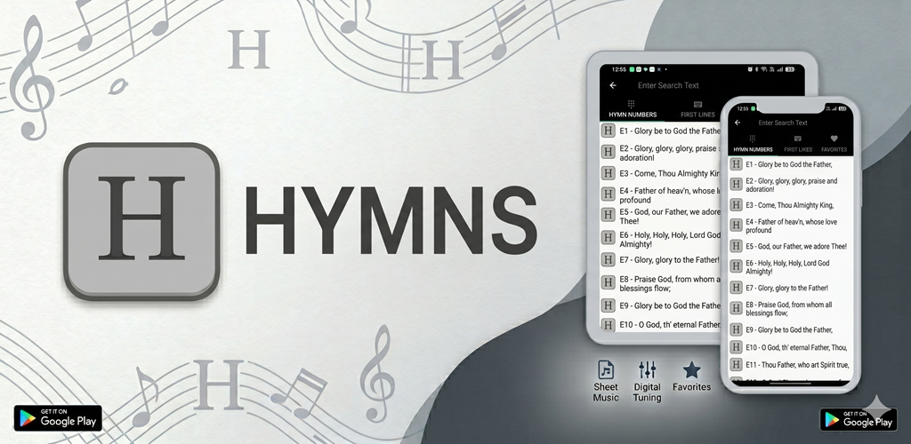

# Hymns For Android

[](https://github.com/lemuelinchrist/hymnsforandroid/releases)
[](https://developer.android.com/about/versions/nougat)
[](https://play.google.com/store/apps/details?id=com.lemuelinchrist.android.hymns)
[](https://lemuelinchrist.github.io/hymnsforandroid/)

<p align="center">
  
</p>

## Download

Hymns For Android is available to download on the Google Play Store:

[](https://play.google.com/store/apps/details?id=com.lemuelinchrist.android.hymns)

Alternatively, you can download the APKs directly from the [GitHub Releases](https://github.com/lemuelinchrist/hymnsforandroid/releases) page.

> [!WARNING]
> **Important Note for Upgrading Users:**  
> Starting with version v5.0+, the app is signed using a new, more secure 4096-bit signing key (upgraded from the legacy 1024-bit key). Due to this signature change, you cannot install this version as an in-place upgrade over versions prior to v5.0.  
> **You must uninstall the old version of the app first** before installing the new release from Google Play or via the APK.

## iPhone, iPad and Computers (Web Version)

The same hymns are also available as a web app for iPhone, iPad and computers:

[](https://lemuelinchrist.github.io/hymnsforandroid/)

**https://lemuelinchrist.github.io/hymnsforandroid/**

- **iPhone / iPad:** open the link in Safari, tap the **Share** button, then **Add to Home Screen**. It then opens like an app,
  with its own icon, and works without internet.
- **Computers:** open the link in any modern browser (Chrome, Edge, Safari, Firefox). Chrome and Edge can also install it as an app.
- It has all the hymnals, search, favorites, each hymn's tune (Play), and the sheet music for piano and guitar with transposing
  and a chords-over-lyrics mode. Pianists can also edit the chords of a sheet.
- Favorites can be moved between the Android app and the web app (Settings → Import/Export Faves on Android, Favorites in the web app).
- The first visit downloads the hymns (about 10 MB); after that they stay on the device. Updates arrive by themselves.

Each [GitHub Release](https://github.com/lemuelinchrist/hymnsforandroid/releases) also includes a single offline HTML file
with the lyrics only, for anyone who cannot use the web app.


## Overview

Hymns For Android is a comprehensive digital hymnal application that provides access to a collection of Hymns and Spiritual Songs with lyrics and sheet music for both piano and guitar. The app is designed to be a convenient replacement for traditional hymn books, offering a user-friendly interface and powerful search capabilities.

## Features

- **Complete Hymnal**: Access to a comprehensive collection of hymns in the Lord's Recovery, in 23 books (languages and collections)
- **Sheet Music**: View sheet music for piano and guitar, laid out to fit the screen, with transposing and a chords-over-lyrics mode
- **Search Functionality**: Easily find hymns by title, lyrics, or number
- **Favorites**: Save your favorite hymns for quick access
- **Material Design UI**: Modern, intuitive user interface
- **Offline Access**: All hymns available without internet connection
- **Compatibility**: Works on Android 7.0 (Nougat) and above
- **iPhone, iPad and computers**: a [web version](https://lemuelinchrist.github.io/hymnsforandroid/) that installs to the home screen and works offline (`tools/web/`); each release also has a single-file lyrics-only version (`tools/ios/`)

## Sheet Music

There is a single build. Piano or guitar is a setting in the app (Settings → Sheet Music Type) and can also be
switched inside the sheet music viewer.

## Project Structure

- **app**: Main application module
- **sqlite**: SQLite database module for hymn data storage
- **databaseProvisioner**: Module for generating and provisioning the hymn database
- **tools**: The iOS web build, the sheet-music converter (SVG → LilyPond → MEI) and the translated sheet-lyrics aligner

For more details, see the [Functional & Data Specification](docs/HYMNAL_SPEC.md), the [Database Specification](docs/database_spec.md) and the [App Architecture](docs/APP_ARCHITECTURE.md).

## Development Setup

### Prerequisites

- Android Studio with support for Android Gradle Plugin 8.13
- JDK 17
- Android SDK 36
- `sqlite3` on the `PATH` (the build imports the database from `sqlite/hymns.sql`)
- Python 3 (for the iOS web build that runs with release builds)

### Building the Project

1. Clone the repository:
   ```
   git clone https://github.com/lemuelinchrist/hymnsforandroid.git
   ```

2. Open the project in Android Studio

3. Build the project:
   ```
   ./gradlew assembleDebug
   ```

   The database will be automatically imported during the build process.

### Release Build

To create a release build:

```
./gradlew clean assembleRelease bundleRelease
```

This produces the APK in `app/build/outputs/apk/release/`, the Google Play bundle (`.aab`) in
`app/build/outputs/bundle/release/`, and the iOS web version in `app/build/outputs/ios/`. Release signing needs
`keystore.properties`. See `AGENTS.md` §7 for publishing a GitHub release.

## Rebuilding or Customizing the App

Want to build your own version, such as a website, a PWA, an iOS app or a customized Android app? The
[Functional & Data Specification](docs/HYMNAL_SPEC.md) is available for anyone who wants to rebuild and customize
the app. It describes the data, the rules for displaying hymns, search, navigation, settings and the sheet music
viewer in enough detail to build an equivalent app without reading the Android code, and includes a guide for
building a PWA and a set of acceptance tests.

## Contributing

Contributions are welcome! If you'd like to contribute to Hymns For Android, please:

1. Fork the repository
2. Create a feature branch
3. Make your changes
4. Submit a pull request

## License

This project is licensed under the terms found in the LICENSE file in the root directory.

## Contact

For questions or support, please open an issue on the GitHub repository.

---

*Hymns For Android - Worship anytime, anywhere.*
