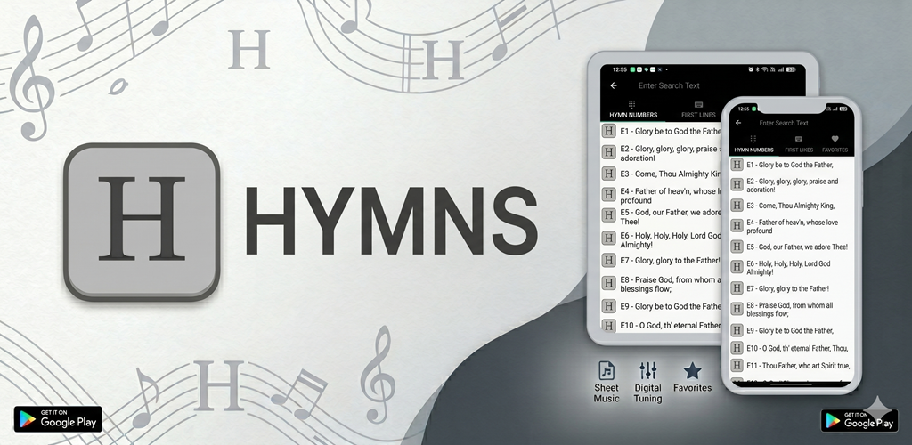

# Hymns For Android

[](https://github.com/lemuelinchrist/hymnsforandroid/releases)
[](https://developer.android.com/about/versions/nougat)
[](https://play.google.com/store/apps/details?id=com.lemuelinchrist.android.hymns)
[](https://lemuelinchrist.github.io/hymnsforandroid/)

<p align="center">
  
</p>

## Download

Hymns For Android is available to download on the Google Play Store:

[](https://play.google.com/store/apps/details?id=com.lemuelinchrist.android.hymns)

Alternatively, you can download the APKs directly from the [GitHub Releases](https://github.com/lemuelinchrist/hymnsforandroid/releases) page.

> [!WARNING]
> **Switching from the APK to the Google Play version?**  
> Uninstall the APK version first, then install the app from Google Play. Otherwise the installation may fail, because the two versions are signed differently.

## iPhone, iPad and Computers (Web Version)

The same hymns are also available as an offline web app:

[](https://lemuelinchrist.github.io/hymnsforandroid/)

**https://lemuelinchrist.github.io/hymnsforandroid/**

- **iPhone / iPad:** open the link in Safari, tap **Share**, then **Add to Home Screen**. It works offline after the first visit.
- **Computers:** open the link in any modern browser.
- It has all the hymnals, search, favorites, tunes, and sheet music for piano and guitar. Favorites can be moved between the Android app and the web app.

## Overview

**Our mission** is to gather, in one place, the hymns and songs sung by the saints in the Lord's recovery around the world, in many languages, so that every believer can find, sing and share them.

Hymns For Android started as an Android app, but it is no longer only for Android users: it is now for everyone. The same hymns are available on Android, on iPhone and iPad, and on computers through the web app.

It is a digital hymnal with lyrics, sheet music for piano and guitar, and recordings. It is a convenient replacement for traditional hymn books, with a user-friendly interface and powerful search.

## Features

- **Complete Hymnal**: Access to a comprehensive collection of hymns in the Lord's Recovery, in 23 books (languages and collections)
- **Sheet Music**: View sheet music for piano and guitar, laid out to fit the screen, with transposing and a chords-over-lyrics mode
- **Search Functionality**: Easily find hymns by title, lyrics, or number
- **Favorites**: Save your favorite hymns for quick access
- **Material Design UI**: Modern, intuitive user interface
- **Offline Access**: All hymns available without internet connection
- **Compatibility**: Works on Android 7.0 (Nougat) and above
- **iPhone, iPad and computers**: a [web version](https://lemuelinchrist.github.io/hymnsforandroid/) that installs to the home screen and works offline (`tools/web/`)

## Sheet Music

There is a single build. Piano or guitar is a setting in the app (Settings → Sheet Music Type) and can also be
switched inside the sheet music viewer.

## Project Structure

- **app**: Main application module
- **sqlite**: SQLite database module for hymn data storage
- **databaseProvisioner**: Module for generating and provisioning the hymn database
- **tools**: The iOS web build, the sheet-music converter (SVG → LilyPond → MEI) and the translated sheet-lyrics aligner

For more details, see the [Functional & Data Specification](docs/HYMNAL_SPEC.md), the [Database Specification](docs/database_spec.md) and the [App Architecture](docs/APP_ARCHITECTURE.md).

## Development Setup

### Prerequisites

- Android Studio with support for Android Gradle Plugin 8.13
- JDK 17
- Android SDK 36
- `sqlite3` on the `PATH` (the build imports the database from `sqlite/hymns.sql`)
- Python 3 (for the iOS web build that runs with release builds)

### Building the Project

1. Clone the repository:
   ```
   git clone https://github.com/lemuelinchrist/hymnsforandroid.git
   ```

2. Open the project in Android Studio

3. Build the project:
   ```
   ./gradlew assembleDebug
   ```

   The database will be automatically imported during the build process.

### Release Build

To create a release build:

```
./gradlew clean assembleRelease bundleRelease
```

This produces the APK in `app/build/outputs/apk/release/`, the Google Play bundle (`.aab`) in
`app/build/outputs/bundle/release/`, and the iOS web version in `app/build/outputs/ios/`. Release signing needs
`keystore.properties`. See `AGENTS.md` §7 for publishing a GitHub release.

## Rebuilding or Customizing the App

Want to build your own version, such as a website, a PWA, an iOS app or a customized Android app? The
[Functional & Data Specification](docs/HYMNAL_SPEC.md) is available for anyone who wants to rebuild and customize
the app. It describes the data, the rules for displaying hymns, search, navigation, settings and the sheet music
viewer in enough detail to build an equivalent app without reading the Android code, and includes a guide for
building a PWA and a set of acceptance tests.

## Contributing

Contributions are welcome! If you'd like to contribute to Hymns For Android, please:

1. Fork the repository
2. Create a feature branch
3. Make your changes
4. Submit a pull request

## License

This project is licensed under the terms found in the LICENSE file in the root directory.

## Contact

For questions or support, please open an issue on the GitHub repository.

---

*Hymns For Android - Enjoy the Lord through singing anytime, anywhere.*
