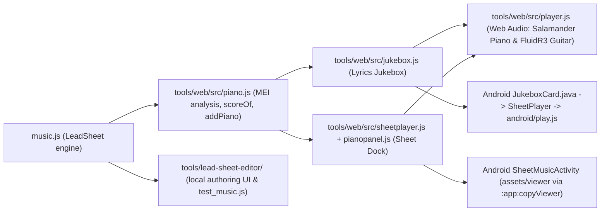

# Accompaniment & Dynamic Styles — Technical Reference

This document explains how Hymns For Android generates, voices, varies, and plays piano and guitar accompaniments across the **Android app**, the **Web app (PWA)**, and the **Lead sheet editor**.

---

## 1. Architecture & Single Source of Truth

All musical generation rules live in one pure-JavaScript module with zero DOM dependencies:

- **[`tools/lead-sheet-editor/music.js`](../tools/lead-sheet-editor/music.js)** (`window.LeadSheet` / CommonJS `module.exports`) — chord parsing, voicings, guitar shapes, style/mood tables, phrase-level variation (`accompanyOn`), passing notes (`passingNotes`), right-hand harmony fills (`fillUnder`), MEI bar export (`barMei`), and expressive dynamics (`melodyVel`, `fillVel`, `leftDyn`).

Everything else consumes `music.js` directly so the Android app, Web app, and Lead sheet editor always sound and notate identically:

### User-Facing Categories & Styles

Both the Jukebox (`tools/web/src/jukebox.js` & `JukeboxCard.java`) and the Sheet Music Unified Bottom Dock (`tools/web/src/pianopanel.js`) present the same organized catalog:

| Category | Style | Engine Path (`family/kind/rhythm`) | Default RH | Shuffle (`↻`) | Moods |
|---|---|---|---|---|---|
| **Hymn's own** | The hymn's own style | From sheet `<identifier type="hands">` (or 4-part voiced score) | Sheet-defined | — | — |
| **Piano** | **Plain** | `strike/hymn/half` | 1 note (melody) | No | — |
| **Piano** | **Chorale** | `dynamic/chorale/half` (+ `More walking` switch) | 2 notes (`beat`) | No | — |
| **Piano** | **Flowing** *(default)* | `dynamic/adaptive/8` | 2 notes (`chord`, whisper) | **Yes** | 6 calm moods |
| **Piano** | **Lively** | `dynamic/pulse/8` | 2 notes (`chord`) | **Yes** | 5 upbeat moods |
| **Piano** | **Walking** | `dynamic/walking/4` | 2 notes (`chord`) | No | — |
| **Guitar** | **Fingerpicking** | `guitar/pick/8` | 1 note | **Yes** | 8 fingerstyle moods |
| **Guitar** | **Folk strum** *(guitar default)* | `guitar/folk/8` | 1 note | **Yes** | 6 acoustic strum moods |
| **Guitar** | **Ballad** | `guitar/ballad/8` | 1 note | **Yes** | 5 lyrical ballad moods |
| **Guitar** | **Country** | `guitar/country/8` | 1 note | No | — |
| **Melody** | **Melody alone** | No accompaniment (`mute: {c, f, l}`) | 1 note | No | — |

*(The lead sheet editor also exposes the low-level `strike`, `bass`, `arp`, and `dynamic/rolled` families for manual arranging.)*

---

## 2. Core Generation Pipeline (`analyse` & `accompanyOn`)

1. **Sixteenth-Note Grid:** Every bar, beat, note onset, and chord position is measured in sixteenths (`g` from the first bar line).
   - `beatLen`: `6` sixteenths for compound meters (`6/8`, `9/8`, `12/8`), otherwise `16 / meter.unit`.
   - **`dottedFeel()` (`piano.js`):** A `3/4` hymn whose melody primarily articulates positions `0` and `6` (two dotted-quarter pulses, e.g. `E16`) is automatically treated as `6/8` for accompaniment and passing notes so pulses align with the tune.
2. **Chord Timing (`chordsOnBeat` / `chordSpans`):**
   - Chords play at their exact written time — including off-beat ("and") syncopations.
   - Two chords closer than `MIN_APART = 2` sixteenths collapse to one (preferring the chord on a beat).
3. **Stretch Segmentation (`accompanyOn`):**
   - The timeline is cut at every bar line, chord change, and mid-song pattern change.
   - **Upbeat bar:** Left empty (`first` skips incomplete bar 0).
   - **Bar/chord restarts:** A pattern restarts cleanly on every chord change and bar line (`fresh = true` when a chord begins in that bar; `fresh = false` on continuation bars).
   - **Ending bar vs. Loop:** On the last sounding bar (`lastBar`), normal playback plays a single held closing chord (`isEnding`). When `loop` is enabled (`acc.end = false`), the last bar continues the active pattern into the next pass — and if the hymn has an upbeat, `piano.js` fills the upbeat's missing beats (`gapG`) with steady accompaniment so loops never stall.
4. **Hands Never Cross:**
   - For piano styles, `accompanyOn` checks `melLow(st.g, st.d)` (lowest sounding melody/fill note) and drops the bass figure (`fig`) or middle chord (`mid`) whole by an octave if any note reaches the right hand, clamped above `E2` (MIDI 40; `36` min shift) for bass and `C3` (MIDI 48) for middle chords so low melodies never turn muddy.
   - Guitar styles stay locked to the guitar's physical string pitches.
5. **Right-Hand Harmony (`fillUnder`):**
   - Adds `1` or `2` chord tones nearest below the melody (starting at least a minor 3rd below, never below `F3` / MIDI 53), skipping any span where a written `voice2` already sounds.

---

## 3. Pattern Language & Voicing Tokens

Patterns are whitespace-separated steps on a grid of `rate` sixteenths (`0` = one held step across the stretch), parsed by `parsePattern()` and realized per chord by `voicing()`.

| Token | Meaning | Voicing Rule |
|---|---|---|
| `1 3 5 7 8 9 10 12` | Chord ladder degrees upward from bass | Bass starts at or above `low` (default `40` = E2). `9` adds a warm 9th above the octave, automatically falling back to `8` on diminished/slash chords or when a semitone from the melody. |
| `c`, `C` | Middle-register chord (`E3..F#4`) | `c` = 3rd + 5th (or 7th); `C` = full chord. With `smooth: true`, picks the compact inversion in `[48..66]` closest to the previous chord's average pitch (`prevMid`). |
| `t` | Chorale tenor voice | Single chord tone in `[max(48, bass+3) .. min(64, under-1)]`, minimizing leap from `prevTen` while penalizing doubling the bass (`+5`) or melody (`+3`). |
| `w` | Walking / connecting bass | `walkPitch()` inserts a diatonic passing step (on a 3rd/4th bass move) or a chord tone 1–2 semitones from the next chord's bass. |
| `D` | Guitar full down-strum | All sounding strings of `guitarShape()` (`on`), low to high. |
| `d` | Guitar light treble down-strum | Top 4 strings (`on.slice(-4)`), brisker sweep & lighter touch (backbeat lift on beats 2 & 4 in Folk). |
| `B` | Guitar low-string bass brush | Bottom 3 strings (`on.slice(0, 3)`), warm continuation/anchor stroke. |
| `U` | Guitar airy up-strum | Top 4 strings (`on.slice(-4)`), swept upward from high E down (`e.up = true`) with treble-weighted velocity taper. |
| `K` | Guitar muted chuck | Top 4 strings struck and immediately damped (`e.mute = true`, `roll: 0.004`). |
| `k` | Guitar soft palm-damped brush | Top 4 strings damped softly (`e.mute = true`, `e.softMute = true`, velocity capped `38–54`). |
| `T`, `A` | Guitar thumb bass / alternate bass | `T` = lowest string (`on[0]`); `A` = next string (`on[1]`), dropping to open A2 (`45 + capo`) on 4-string open shapes like `D`/`Dm` when A is a chord tone, or staying on `on[0]` so `A` never duplicates `g`. |
| `g`, `b`, `e` | Guitar G, B, high-E strings | Physical strings 4, 5, 6 of `guitarShape()`. |
| `+`, `-`, `.`, `\|` | Step modifiers | `a+b` simultaneous; `-` tie/hold previous step; `.` rest; `A \| B` bar-1 vs. continuation-bar pattern. |

---

## 4. Phrase-Shuffled Dynamic Engine (`moods`, `vary`, `seed`)

All five phrase-shuffled styles (**Flowing**, **Lively**, **Fingerpicking**, **Folk strum**, **Ballad**) share one unified phrase-variation engine inside `accompanyOn`:

### 4.1 Musical Phrase Scheduling (`moodForBar`)
Instead of picking a random pattern every bar (which sounds scattered) or looping one pattern forever (which sounds robotic), `moodForBar()` groups the song into **2–4 bar musical phrases**:
- Stays in one mood for a full phrase, switching cleanly **immediately after a cadence pause bar** (once at least 2 full bars have played in the current mood) or after **4 full bars**.
- Never selects the same mood twice in a row.
- **Deterministic Seeded PRNG (`rnd`):** Seeded from `songSeed` (derived from chord count, song length, and note count) plus `acc.seed`.
  - `seed = 0`: the hymn's own consistent default arrangement.
  - Tapping the attached **`↻` refresh side-button** assigns a random `seed` (`1..99999`), saved per hymn so the new take plays identically on replay. Tapping the main style pill resets `seed` to `0`.

### 4.2 Context-Aware Figure Slots (`vary`)
Each mood defines meter-specific pattern arrays for 4/4, 3/4, 6/8 (compound), and 2/4 across five musical situations:
- `short`: short chord span (`<= barLen / 2`, e.g. 2 beats in 4/4).
- `calm`: fresh full-bar chord while the melody is moving.
- `cont`: continuation bar (the same chord held into a second bar — typically calmer/lighter).
- `fill`: melody rests or holds from the start of the stretch (`bloom === a`, via `holdFrom()`).
- `late`: melody moves in the first half and then holds/rests (`bloom > a`, swapping to `lateSteps` at `bloom`).

Inside `varyPick()`, a stretch keeps its previous variant 50% of the time so figures cohere naturally across adjacent bars.

### 4.3 Loop & Transition Guards
- **`loopLast`:** On a looping playback's final bar (`acc.end === false && bi >= lastBar`), sparse hold moods (`rolled`, `velvet`, `pluck-calm`, `shimmer`, `breathe`, `harp`) fall back to `acc.moods[0]` so the transition back into bar 1 never feels like a full stop.
- **`settle`:** Holds the note preceding the last beat of a stretch so the hand has room before leaping to the next chord's bass, while explicitly preserving intentional connecting bass pickups (`w`).
- **Flowing `w` smooth-step check:** Optional `w` steps in Flowing are kept only when the next chord actually changes bass and `w` lands within 3 semitones of the next bass; otherwise the previous step holds cleanly.

---

## 5. Tempo-Aware Pacing (Fast-Notated Sheets)

Hymns written in cut-time or brisk notation (e.g. 4/4 at `♩ = 180–200` or 3/4 at `♩ = 180`) would sound frantic at eighth-note grids. When a non-compound bar's eighth-note step duration `(rate / 4) * (60 / bpm)` drops below a style's threshold, `accompanyOn` automatically doubles `rate` (`rate *= 2`) and switches to tailored quarter-feel figures:

| Style | Threshold (per eighth) | Relaxed Quarter-Feel Behavior |
|---|---|---|
| **Flowing** (`adaptMoods`) | `< 0.21s` (`ballad`: `< 0.27s`) | Spacious quarter arches (`1 5 c 8`, `1+5+10 - c -`, `1 5 c w`) |
| **Lively** (`pulseMoods`) | `< 0.175s` | Crisp quarter bounce/drive/gospel (`1 c 5 c`, `1+c c 5+c c`, `1 c 5 w`) |
| **Fingerpicking** (`guitarPickMoods`) | `< 0.21s` | Relaxed quarter-note thumb/arpeggio/plucked chords (`T+b g A b`, `T g b e`) |
| **Folk strum** (`guitarFolkMoods`) | `< 0.175s` | Mood-matched quarter strums (`D d U d`, `T d A d`, `D - d U`, `D k d U`, `T g d U`) |
| **Ballad** (`guitarBalladMoods`) | `< 0.175s` | Spacious quarter/half swells (`D - d U`, `T - A d`, `D - g b`, `D - B -`) |

---

## 6. Style-by-Style Implementation Details

### 6.1 Piano Styles

#### Plain (`strike/hymn/half`)
- Pattern: `1+5 | c` twice a bar (root + fifth on chord changes, middle voicing on continuation bars), melody alone in the right hand. Clean, simple, unobtrusive hymn foundation.

#### Chorale (`dynamic/chorale/half`)
- **4-Part Voiced Sheets (`<identifier type="parts">`):** When the MEI carries all four written SATB parts, Chorale plays the hymnal's actual alto, tenor, and bass voices (`useParts` in `piano.js`) rather than generating from chords.
- **Lead Sheets:** Plays `1+t` (bass + voice-led tenor) with `rh: {add: 1, on: 'beat'}` to form 4-part hymn texture.
- **Passing Notes (`passingNotes()`):**
  - Default (`passing: 1`): When bass (or else tenor) leaps a 3rd into the next chord on a ≥2-beat chord, inserts the diatonic passing note on the final beat (avoiding semitone clashes with the melody).
  - **More walking** (`passing: 2`, toggled via the Chorale switch): Both voices may walk; 4ths walk in two steps (two beats or two eighth halves); long chords (≥4 beats, or ≥2–3 beats under a held melody note) step the bass to another chord tone halfway toward the next bass.

#### Flowing `↻` (`dynamic/adaptive/8`) — *Default Piano Style*
Flags: `bassRing`, `chordPedal`, `adaptive`, `smooth`, `settle`, `feather`, `roll: 0.020`, `rh: {add: 1, on: 'chord'}` (whisper-soft fill at 55% melody velocity with `12 ms` bloom roll).
- **Smart Damper Pedal (`chordPedal`):** Sustains inner notes up to 14 sixteenths per chord, lifting cleanly (`ring - 0.35`) right before a chord change or connecting bass step `w`.
- **Feathered Dynamics (`feather`):** Softer base curve (`68 / 58 / 52 / 45`), continuation bars `-4`, melody pauses `-5`, upper single-note shimmer attenuated by pitch height and laid back `3–8 ms`.
- **6 Phrase-Shuffled Moods (`adaptMoods`):**
  1. **`sway`** (`roll: 0.018`): Unhurried 3-3-2 pedaled sway (`1 - - 5 - - c -`) with warm 9th/10th fills.
  2. **`serene`** (`roll: 0.016`): Flowing quarter-note arches (`1 - 5 - 10 - 8 -`).
  3. **`velvet`** (`roll: 0.024`): Spacious cushioned chords (`1 - 5 - c - - -`) with soft pause swells (`1+5 - - - 9 - - -`).
  4. **`walk`** (`roll: 0.018`): Lyrical arches with quiet connecting bass pickups (`w`) into chord changes.
  5. **`rolled`** (`roll: 0.030`): Lush harp-like rolled tenth chords (`1+5+10 - - - c - - -`).
  6. **`ballad`** (`roll: 0.018`, `halfTimeMs: 0.27`): Classic syncopated piano ballad arches (`1 - 5 8 10 - 8 5`).

#### Lively `↻` (`dynamic/pulse/8`)
Flags: `smooth`, `adaptive`, `bouncy`, `roll: 0.006`, `rh: {add: 1, on: 'chord'}`.
- **Crisp Bounce Articulation (`bouncy`):** Tight `6 ms` chord roll, accented downbeats (`+6`), lifted syncopated pushes (`+12`) and chord pops (`+6..9`), and detached mid-chord durations (`min(d * 0.62, d - 0.35)`) so upbeat chords pop crisply instead of smearing.
- **5 Phrase-Shuffled Moods (`pulseMoods`):**
  1. **`pop332`**: Upbeat 3-3-2 acoustic pop pulse (`1 - - c - - 5 -`).
  2. **`bounce`**: Classic cheerful hymn bounce (`1 - c - 5 - c -`).
  3. **`drive`**: Driving quarter-chord rhythm (`1+c - c - 5+c - c -`).
  4. **`gospel`**: Joyful walking/gospel pickups (`1 - c - 3 - c w`).
  5. **`sparkle`**: Bouncy rhythmic arpeggios (`1 5 c - 5 c 8 -`).

#### Walking (`dynamic/walking/4`)
- Pattern: `1 5 8 w` (4/4), `1 5 w` (3/4), `1 w` (2/4), `1 - 5 8 - w` (6/8) with `rh: {add: 1, on: 'chord'}` (Two notes by default) so the bass steps smoothly into every chord change.

---

### 6.2 Guitar Engine & Styles

#### Open Shapes, Capo & Slash-Bass Playback (`guitarShape`)
- Maps each chord to real open-position guitar shapes in frets `0–4` across `[E2, A2, D3, G3, B3, E4]` (`C = x32010`, `G = 320003`, `D = xx0232`, `G/B = x20003`, `D/F# = 200232`).
- **Capo + Slash Basses:** Guitar sheets hide slash basses visually for readability, and transpose displayed chord names down by the key's capo (`CAPO` table in `sheet.js`). During playback, `sheet.js` keeps all original slash chords in `view.soundXml`, and `guitarShape(c, capo)` shifts both `root` and `bass` down by `capo` (`bass = c.bass - cp`) and sounds the shape above the capo (e.g. `E/G#` with Capo 4 plays the `C/E` shape `032010` above fret 4, sounding `G#2` in the bass).
- **Clean Slash-Bass Muting:** When a slash bass sits within 2 semitones below the adjacent upper string, that adjacent string is muted (`Am/G` → `3x2210`, `F/G` → `3x3211`, `Dm/C` → `x3x231`) so the low end stays clear.
- **4-String Alternating Thumb (`A`):** On 4-string open shapes (`D`, `Dm`), `A` drops to the open 5th string (`A2 + capo`) when it is a chord tone; on 4-string slash voicings (`Dm/C`), `A` avoids duplicating the G string.

#### Natural Per-String Let-Ring
- Picked steps (`e.pluck = true`, both in Fingerpicking and picked bass/arpeggio steps inside Folk/Ballad) compute per-string ring durations (`e.rings`, capped at chord end or 16 sixteenths).
- A ringing string damps only when that same pitch is re-plucked, a mute (`K`/`k`) occurs, or a subsequent strum reaches/crosses that string (`nx.p[0] <= pitch`). This means a plucked bass note (`T`/`A`) rings naturally underneath light treble strums (`d`/`U`), just like a real acoustic guitar.

#### Dynamic Strum Articulation (`strumDyn` in `accompanyOn` & `leftDyn`)
Used by both **Folk strum** and **Ballad**:
- **Variable sweep speeds (`roll`):**
  - Folk: `16 ms` on fresh downbeat `D`, `13 ms` on inner `D`, `24 ms` on pause `D`, `9.5 ms` on `d`, `11 ms` on `B`, `7.5 ms` on upward `U`, `5.5 ms` on soft mute `k`, `30 ms` on ending chord.
  - Ballad (`softStrum: true`): slower, warmer `20–28 ms` on `D`, `11.5 ms` on `d`, `14 ms` on `B`, `9 ms` on `U`, `36 ms` on ending chord.
- **String-by-string velocity contour:**
  - `D`: grounded bass strings (`+3` on lowest two), balanced middle (`-1`), light top shimmer (`+1`).
  - `B`: warm lowest string (`+3`), tapered upper two (`-2`).
  - `d`: crisp treble skim (`+2` on top two, `-2` on lower two), with a natural backbeat lift on beats 2 & 4 (4/4) and beat 2 (3/4) in Folk.
  - `U`: airy upward sweep peaking on the highest string (`+2`) and tapering `-2` per lower string.
  - `k`: gentle woody damped pocket (`38–54` velocity).
- Continuation downbeats (`e.cont`) relax `-5`, melody pauses (`e.pause`) taper `-4..-6`, and Ballad adds an overall `-3` intimate dynamic cushion (`e.softStrum`).

#### Folk strum `↻` (`guitar/folk`) — *6 Phrase-Shuffled Moods (`guitarFolkMoods`)*
1. **`campfire`**: Dynamic island strum (`D - d U - U d U` / continuation `B - d U - U - U`).
2. **`bassfolk`**: Singer-songwriter plucked root/alternate bass ringing under treble strums (`T - d U - U d U` / `T - d U A - d U`).
3. **`push`**: Syncopated acoustic 3-3-2 worship lift (`D - - U - d U -`).
4. **`breathe`**: Spacious open verse strumming (`D - - - d U - U`).
5. **`pocket`**: Organic groove with soft palm-damped brush (`D - k U - U d U`).
6. **`hybrid`**: Picked thumb + treble strings flowing into brushed strums (`T g d U - U d U`).

#### Ballad `↻` (`guitar/ballad`) — *5 Phrase-Shuffled Moods (`guitarBalladMoods`)*
All moods set `softStrum: true` and lush `roll` (`20–28 ms`):
1. **`open`** (`roll: 0.022`): Breathing open ballad swells (`D - - - d - d U`).
2. **`lullaby`** (`roll: 0.020`): Intimate bass-to-brush sway (`T - - d - - d U`).
3. **`shimmer`** (`roll: 0.022`): Slow strum answered by shimmering high picked strings (`D - - g b - d U`).
4. **`sway`** (`roll: 0.021`): Lyrical dotted-quarter ballad sway (`D - - U - - d U`).
5. **`harp`** (`roll: 0.028`): Extra-slow harp-like rolled acoustic blooms (`D - - - B - - U`).

#### Country (`guitar/country`)
- Classic alternating-bass boom-chick (`T - D U A - D U` in 4/4, `T - D U D U | A - D U D U` in 3/4, `T D U A D U` in 6/8, `T D A D` in 2/4).

#### Fingerpicking `↻` (`guitar/pick`) — *8 Phrase-Shuffled Moods (`guitarPickMoods`)*
Flags: `pick`, `adaptive`, `settle`. Legacy saved picking IDs (`travis`, `pick-flow`, `arp`, `harp`, `arp-flow`) automatically normalize to `pick`.
1. **`pinch`**: Thumb + treble pinch (`T+b - g - A - e b`).
2. **`travis`**: Alternating-bass Travis picking (`T - b g A - e g`).
3. **`quarters`**: Calm quarter-note picking (`T - g - A - b -`).
4. **`arch`**: Rising & falling ballad arpeggio (`T g b e - - b g`).
5. **`shimmer`**: Rising chord with ringing top shimmer (`T g b e - - - -`).
6. **`harp`**: Serene upward quarter-note harp (`T - g - b - e -`).
7. **`pluck-calm`**: Breathing 4-string simultaneous plucked chords (`T+g+b+e - - - A+g+b+e - - -`).
8. **`pluck-groove`**: Syncopated 3-3-2 / alternating 4-string plucked chords (`T+g+b+e - - g+b+e - - A+g+b+e -`).

---

## 7. Audio Synthesis & Playback Engine (`tools/web/src/player.js`)

- **Piano (Salamander Grand Piano, Yamaha C5, CC-BY 3.0):**
  - 22 minor-3rd MP3 samples (`A1`–`C7`, `vendor/piano/`), loaded progressively in 2 stages (5 core octaves first for instant playback, remaining 17 in background), with a periodic-wave synthesizer fallback.
  - Velocity-sensitive low-pass warmth (`900 Hz`–`18 kHz`), register-dependent damper release, and a lightweight stereo room convolver (automatically bypassed inside Android WebViews `; wv)` to keep audio glitch-free on tablets).
- **Guitar (FluidR3 GM Steel-String Acoustic, CC-BY 3.0):**
  - 13 minor-3rd MP3 samples (`E2`–`E5`, `vendor/guitar/`), with a Karplus-Strong plucked-string fallback while samples load.
  - Four selectable **Tone** profiles (`GUITAR_TONES`: `bright`, `warm` default, `mellow`, `soft`), routed through a shared per-tone `guitarBus` (200 Hz wood body + 3 kHz pick shelf) so each string voice needs only one low-pass filter.
  - Fingerpicked notes (`e.pluck`) get a softer attack (`+5 ms`), warmer low-pass/body, and gentler release tail (`140 ms` vs `70 ms` for strums); muted strokes (`e.mute`) clamp duration to `35 ms` at `1200 Hz` with `25 ms` decay.
  - On the guitar sheet and in Jukebox guitar styles, the melody also plays on the sampled steel-string guitar (`vel * 1.2`) so melody and strumming blend on one instrument.

---

## 8. Persistence, Sheet Overrides & Verification

- **Per-Hymn Storage:** Style choices are stored per hymn in `localStorage` (`handsByHymn` for piano sheet, `strumByHymn` for guitar sheet). Legacy device-wide/Advanced keys are cleared on load (`forgetOldChoices()`).
- **Sheet Default Override:** A sheet MEI may declare its own default accompaniment via `<identifier type="hands">family/kind/rhythm [rh=add:on]</identifier>` (surfaced under the **Hymn's own** tab). Sheets without one default to **Flowing** on piano and **Folk strum · Warm** on guitar.
- **Verification:**
  - `node tools/lead-sheet-editor/test_music.js` — unit tests covering chord parsing, guitar capo/slash voicings, every time signature, all dynamic moods, deterministic shuffling, fast-tempo relaxation, dynamics, and Verovio MEI output.
  - `python3 tools/web/build.py` — bundles `music.js` and `tools/web/src` into `tools/web/dist/`.
  - `JAVA_HOME=/home/lemue/.jdk ./gradlew :app:testDebugUnitTest :app:lintDebug :app:assembleDebug` + `node tools/web/tests/android.cjs` — copies shared viewer assets via `:app:copyViewer` and verifies both native Android (`JukeboxCard`, `StringsTranslationsTest`) and the Android sheet WebView.
